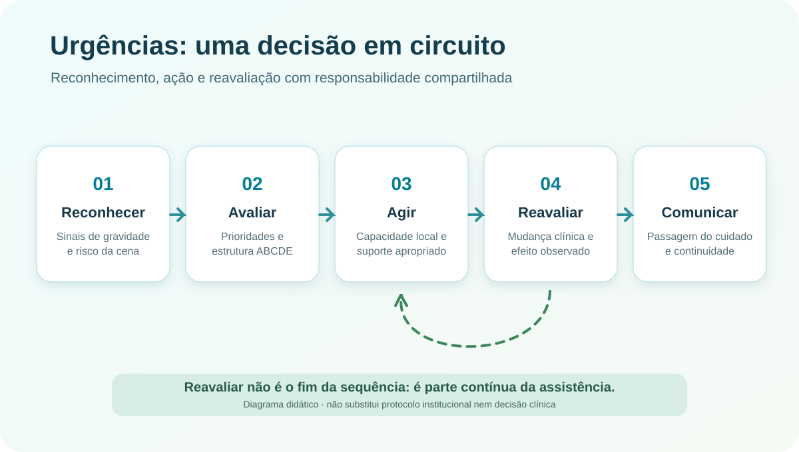

# Urgências e prioridades assistenciais

**Revisão técnico-editorial: 8 de novembro de 2026.** Este caderno apresenta princípios de atendimento a situações agudas para estudo, documentação e desenvolvimento de sistemas. Não é ferramenta de triagem de pacientes reais, não substitui protocolos locais, treinamento, decisão clínica profissional ou regulação de urgência. Em situação de emergência no Brasil, acione o **SAMU 192** ou o serviço de emergência disponível. [1]

Uma emergência não é definida apenas pelo nome de uma doença: depende da ameaça imediata à vida ou à função, da evolução e do tempo disponível para agir. A prática segura reúne reconhecimento precoce, prioridades explícitas, intervenção proporcional à capacidade do serviço, reavaliação e comunicação. Não basta identificar um diagnóstico plausível; é necessário reconhecer o que não pode esperar.

*Ilustração conceitual original; representa a organização do cuidado, não um algoritmo de decisão clínica validado.*

## 1. Emergência, urgência e decisão sob tempo limitado

**Urgência** designa uma necessidade de atenção em intervalo oportuno, conforme risco e sofrimento; **emergência** envolve ameaça imediata ou muito próxima, exigindo atuação sem atraso indevido. A classificação não decorre apenas da queixa nem da ordem de chegada. Uma dor torácica discreta pode corresponder a doença grave, enquanto sintomas intensos também podem ter causas que não ameaçam a vida. A classificação de risco deve ser realizada por profissionais habilitados, com protocolos adotados pelo serviço e possibilidade de reclassificação se houver mudança clínica.

Há três tempos distintos: o tempo de **reconhecer** a gravidade, o tempo até a **primeira ação pertinente** e o tempo para alcançar o **cuidado definitivo**. Minimizar um deles à custa de perda de segurança em outro nem sempre melhora o resultado. A Rede de Atenção às Urgências (RUE) do Sistema Único de Saúde (SUS) articula diferentes pontos de atendimento, da atenção primária ao componente pré-hospitalar e hospitalar. [2]

## 2. Segurança da cena, acolhimento e acionamento de ajuda

Antes da avaliação, a equipe considera perigos ambientais, exposição a violência, eletricidade, trânsito, produtos químicos e riscos infecciosos. A organização do trabalho inclui equipamentos de proteção, acesso seguro, pedido de reforço e identificação de quem coordena a comunicação. A segurança da equipe não é um elemento secundário: um profissional que se torna vítima deixa de poder prestar assistência.

Sinais como perda de consciência, dificuldade respiratória importante, dor torácica súbita, suspeita de acidente vascular cerebral (AVC), convulsão prolongada, trauma com vítimas, hemorragia importante e queimaduras graves exigem acionamento apropriado da rede de urgência. O Ministério da Saúde descreve essas situações entre os motivos para chamar o SAMU 192. [1] Informar localização precisa, riscos da cena, número de pessoas envolvidas e condição observada ajuda a regulação; não se deve retardar o pedido de socorro para completar um formulário.

## 3. Avaliação primária estruturada: ABCDE

O método **ABCDE** organiza uma primeira busca de ameaças vitais. É uma forma de priorizar problemas, não uma sequência rígida que impeça tratar algo imediatamente reconhecido. O manual *Basic Emergency Care*, da Organização Mundial da Saúde (OMS) e do Comitê Internacional da Cruz Vermelha (CICV), utiliza a abordagem ABCDE e a história SAMPLE para atendimento inicial, inclusive em ambientes com poucos recursos. [3]

- **A — Airway (via aérea):** reconhecer comprometimento da permeabilidade e necessidade de apoio qualificado. Considerar proteção da coluna cervical quando o mecanismo de trauma indicar risco.
- **B — Breathing (respiração):** observar frequência e esforço respiratórios, expansão torácica, oxigenação e sinais de falência ventilatória. Um único valor de oxímetro não substitui avaliação clínica.
- **C — Circulation (circulação):** avaliar perfusão, pulso, pressão quando disponível, pele, sangramentos e sinais de choque. Hemorragia externa grave requer reconhecimento prioritário e medidas por equipe treinada.
- **D — Disability (estado neurológico):** verificar consciência, alterações focais, convulsões e causas reversíveis de alteração mental, incluindo glicemia, quando houver equipamento e treinamento.
- **E — Exposure/Environment (exposição e ambiente):** examinar o necessário para não perder lesões relevantes, preservando privacidade e prevenindo perda de calor.

A avaliação é **iterativa**: alterações após uma medida ou durante a espera de transferência exigem nova observação. Sinais normais isolados não excluem doença grave, sobretudo em idosos, crianças, gestantes e pessoas com condições crônicas.

## 4. Histórico focal e registro temporal

Após estabilização das prioridades imediatas, uma história focal ajuda a reconhecer contexto e riscos. A estrutura **SAMPLE** resume *Signs and symptoms* (sinais e sintomas), *Allergies* (alergias), *Medications* (medicamentos), *Past history* (antecedentes), *Last oral intake* (última ingestão) e *Events* (eventos relacionados). Esse registro não precisa atrasar intervenções prioritárias. [3]

Para sintomas tempo-dependentes, é essencial distinguir **início relatado**, **último momento em que a pessoa estava bem**, **hora da primeira avaliação**, **horário das intervenções** e **horário de encaminhamento**. Horários imprecisos devem ser assinalados como estimados, nunca transformados em horários exatos por conveniência do prontuário.

## 5. Síndromes tempo-dependentes: o que muda na organização

### Dor torácica e suspeita de síndrome coronariana aguda

A síndrome coronariana aguda (SCA) engloba apresentações com diferentes achados e riscos. Avaliação clínica e eletrocardiograma precoce, quando indicados, integram a organização da linha de cuidado; marcadores e outros exames precisam ser interpretados conforme o tempo desde o início dos sintomas e a probabilidade clínica. A diretriz ACC/AHA de 2025 reúne o manejo agudo de angina instável e infarto com ou sem supradesnivelamento do segmento ST. Este artigo não fornece decisões medicamentosas ou de reperfusão, que dependem de protocolos assistenciais e contraindicações. [4]

### Suspeita de AVC ou ataque isquêmico transitório

Alteração súbita da fala, assimetria facial, perda de força, alteração visual ou incapacidade súbita de equilíbrio justificam avaliação urgente. Registrar o último momento conhecido sem sintomas e acelerar o acesso à avaliação especializada são aspectos fundamentais. A diretriz AHA/ASA de 2026 atualizou seleção e organização do tratamento do AVC isquêmico, incluindo triagem pré-hospitalar e decisões por imagem; a abordagem depende do centro, dos recursos e de avaliação especializada. [5]

### Infecção grave e suspeita de sepse

Sepse é uma disfunção orgânica potencialmente fatal associada à resposta desregulada à infecção. A suspeita deve combinar contexto, sinais de comprometimento orgânico e diagnósticos alternativos. A *Surviving Sepsis Campaign* publicou em 2026 uma atualização para adultos, distinguindo probabilidade de infecção, choque, investigação rápida, antimicrobianos e reavaliação hemodinâmica. **Não se deve transformar a recomendação temporal de um subgrupo em prescrição universal para toda febre ou infecção possível.** [6]

### Parada cardiorrespiratória e falência respiratória

Reconhecer rapidamente ausência de resposta e respiração normal, acionar ajuda, iniciar ressuscitação conforme treinamento e disponibilizar desfibrilador externo automático (DEA), quando aplicável, são componentes dos sistemas de resposta. A diretriz da American Heart Association (AHA) de 2025 reforça ressuscitação de qualidade, desfibrilação precoce e organização da cadeia de sobrevivência. A execução de intervenções avançadas exige formação específica e equipamentos apropriados. [7]

### Trauma, sangramento e condições especiais

Trauma grave exige reconhecer risco de lesão oculta, mecanismo, sangramento, alterações ventilatórias e neurológicas, além de definir destino compatível com o cuidado definitivo. Situações obstétricas, pediátricas, intoxicações e anafilaxia exigem caminhos próprios; **um protocolo para adultos não deve ser automaticamente aplicado a crianças ou gestantes**. A documentação deve indicar quando uma condição extrapola os recursos disponíveis e requer apoio especializado.

## 6. Classificação de risco não é diagnóstico

A classificação de risco estabelece prioridade de atenção segundo sinais de gravidade e protocolos institucionais; **não encerra a investigação clínica**. Pacientes inicialmente classificados com menor prioridade podem deteriorar-se. O sistema deve registrar reclassificações, hora, motivo e responsável. Fluxos que exibem uma cor ou número sem critérios e sem reavaliação podem produzir falsa segurança.

Indicadores de fila e desempenho devem ser interpretados com atenção ao perfil de complexidade e à capacidade instalada. Uma métrica como “tempo médio de atendimento” pode ocultar atrasos graves em um pequeno grupo de alto risco. É preferível acompanhar distribuição de tempos por estrato de prioridade, eventos adversos e oportunidades de melhoria.

## 7. Reavaliação após cada decisão relevante

A cada transição — acolhimento, exame, início de suporte, deslocamento, espera por vaga ou transferência — reavaliar ameaças atuais pode mudar a prioridade. No registro, diferenciar **observação**, **hipótese**, **decisão**, **ação realizada**, **resposta observada** e **pendência**. Quando há instabilidade, o cuidado e a comunicação acontecem em paralelo: não se espera o registro estar completo para solicitar ajuda.

A reavaliação também protege contra vieses cognitivos. Ancorar-se no primeiro diagnóstico, minimizar sinais discrepantes ou interpretar ausência de piora imediata como segurança definitiva são erros possíveis. Estratégias de equipe incluem verbalizar incerteza, explicitar critérios de escalonamento e fazer checagem cruzada quando o contexto permite.

## 8. Comunicação, regulação e transferência

Uma transferência útil transmite, de forma concisa, o motivo clínico, estado atual, evolução, intervenções realizadas, resposta e pendências. A estrutura **SBAR** — Situação, Histórico, Avaliação, Recomendação — pode apoiar a transferência de informação, mas não substitui dados objetivos nem protocolos de regulação.

A equipe que recebe precisa saber quais sinais mudaram, quando ocorreram, quais exames estão disponíveis, que riscos exigem vigilância e o que já foi comunicado ao paciente ou acompanhante. Encaminhamento não é sinônimo de solução imediata; o registro deve identificar quem mantém a responsabilidade pelo acompanhamento durante a transição e qual é o plano se houver atraso.

## 9. Estudo de caso fictício: mudança de prioridade

**Caso sintético, não baseado em pessoa real.** Uma pessoa adulta procura uma unidade por mal-estar inespecífico. Na primeira abordagem, conversa normalmente, mas relata cansaço recente e mal-estar progressivo. A equipe registra hora e sinais observados, identifica condições que exigem observação e define reavaliação. Alguns minutos depois, surgem alteração de consciência e sinais de perfusão inadequada. A prioridade muda, a equipe aciona suporte e comunica a evolução em sequência cronológica.

O aprendizado do caso não é adivinhar um diagnóstico único, mas reconhecer que: (1) apresentação inicial pode ser inespecífica; (2) **mudança clínica altera a classificação de risco**; (3) dados temporais e de perfusão mudam o significado da situação; (4) a comunicação precisa transmitir o que mudou, não apenas a queixa inicial. O painel didático permite percorrer esse caso sem guardar dados pessoais.

[Explorar o painel didático de urgências e seus cenários](/projetos/emergencias/)

## 10. Indicadores e vistoria de segurança

Uma ferramenta de melhoria da qualidade pode medir, entre outros itens: tempo até primeira avaliação por prioridade; proporção de reclassificações documentadas; registro do último momento sem sintomas nas suspeitas de AVC; completude de transferências; e casos revistos após incidentes ou retornos inesperados. Cada indicador requer **numerador, denominador, fonte, período e população**, além de análise por grupos pertinentes. Indicadores não equivalem automaticamente a resultados clínicos causais.

Ao comparar serviços, controlar diferenças de perfil, recursos e volume é indispensável para evitar interpretações enganadoras. Auditoria responsável evita publicar histórias clínicas identificáveis, informações de localização de pacientes ou credenciais. As análises devem usar dados fictícios, agregados ou adequadamente autorizados e protegidos.

## 11. Prontuário, automação e aplicações digitais

Sistemas de informação podem apoiar horários, sinais vitais em série, tarefas pendentes, formulários de transferência e comunicação entre pontos da rede. **Não devem autonomamente diagnosticar, classificar pacientes reais ou recomendar doses sem validação clínica, regulatória e operacional apropriada.** Uma versão experimental de portfólio deve manter essa limitação explícita e não aceitar dados identificáveis de pacientes.

Para evolução deste módulo, propõem-se recursos isolados: editor de linhas do tempo fictícias; comparação entre versões de fluxos; painel de qualidade com dados sintéticos; exportação de documentos de transferência para exercícios; e controle de proveniência das diretrizes. O código do protótipo deve ser versionado separadamente de seus textos editoriais.

## 12. Limites, manutenção e responsabilidade

As diretrizes listadas têm públicos e escopos diferentes: treinamento básico, organização do atendimento e tratamento especializado não são intercambiáveis. Este artigo sintetiza conceitos e sinaliza fontes, **não reproduz integralmente protocolos operacionais**. Políticas, estruturas de rede e evidências mudam; uma revisão editorial posterior deve verificar novamente documentos oficiais, ano, país e população-alvo. Não se pode concluir que um sistema ou fluxo esteja clinicamente validado apenas porque passou por testes de software.

## Fontes e leituras verificáveis

- **[1] Ministério da Saúde.** [SAMU 192: quando chamar e como funciona](https://www.gov.br/saude/pt-br/campanhas-da-saude/2025/samu-192). Orientação oficial ao público brasileiro.
- **[2] Ministério da Saúde.** [Portaria GM/MS nº 1.600/2011](https://bvs.saude.gov.br/bvs/saudelegis/gm/2011/prt1600_07_07_2011.html), que instituiu a Rede de Atenção às Urgências. Consultar também atos posteriores e normas consolidadas aplicáveis.
- **[3] OMS/CICV/IFEM.** [Basic Emergency Care: approach to the acutely ill and injured](https://www.who.int/publications/i/item/basic-emergency-care-approach-to-the-acutely-ill-and-injured). Manual aberto de atendimento inicial, 2018, com materiais de ensino posteriormente atualizados.
- **[4] ACC/AHA/ACEP/NAEMSP/SCAI.** [Guideline for Acute Coronary Syndromes (2025)](https://professional.heart.org/en/science-news/2025-guideline-for-the-management-of-patients-with-acute-coronary-syndromes).
- **[5] AHA/ASA.** [Guideline for Early Management of Acute Ischemic Stroke (2026)](https://professional.heart.org/en/science-news/2026-guideline-for-the-early-management-of-patients-with-acute-ischemic-stroke). Para contexto brasileiro, consultar também [SBAVC — diretrizes](https://avc.org.br/membros-e-profissionais/diretrizes-avc/).
- **[6] SCCM/ESICM.** [Surviving Sepsis Campaign: Sepsis and Septic Shock Guidelines (2026)](https://sccm.org/survivingsepsiscampaign/guidelines-and-resources/surviving-sepsis-campaign-adult-guidelines).
- **[7] AHA.** [Guidelines for Cardiopulmonary Resuscitation and Emergency Cardiovascular Care (2025)](https://professional.heart.org/en/science-news/2025-aha-guidelines-for-cpr-and-ecc).

*Fontes consultadas para esta versão: 8/11/2026. As citações fundamentam conceitos selecionados; a seção não constitui uma revisão sistemática.*
